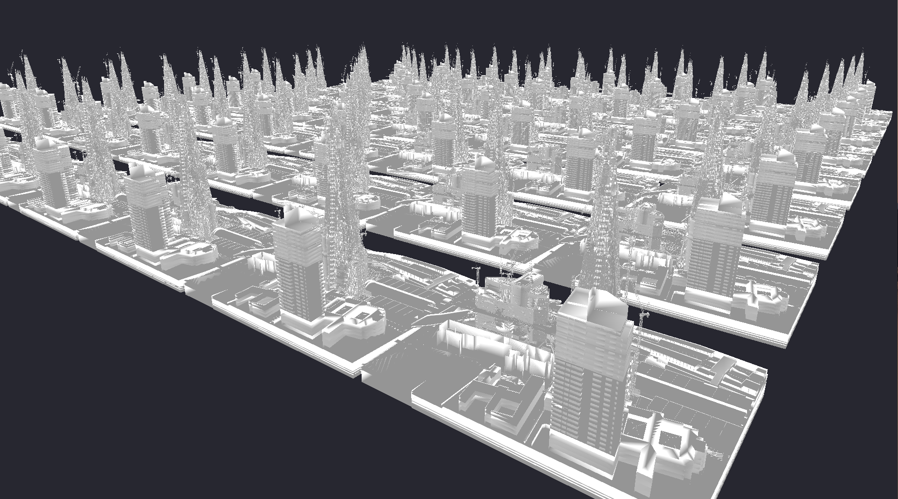
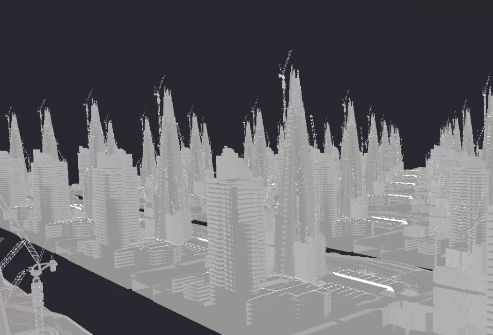
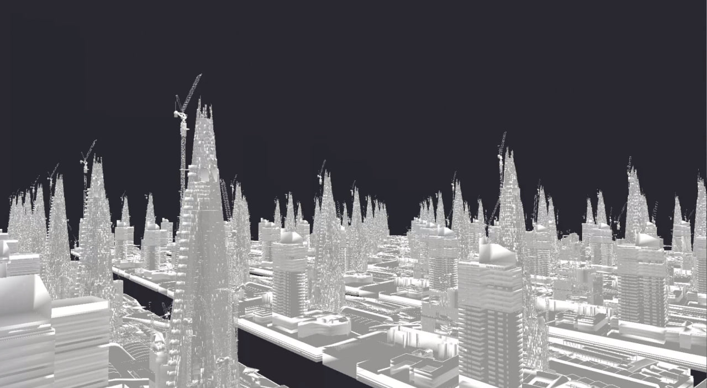
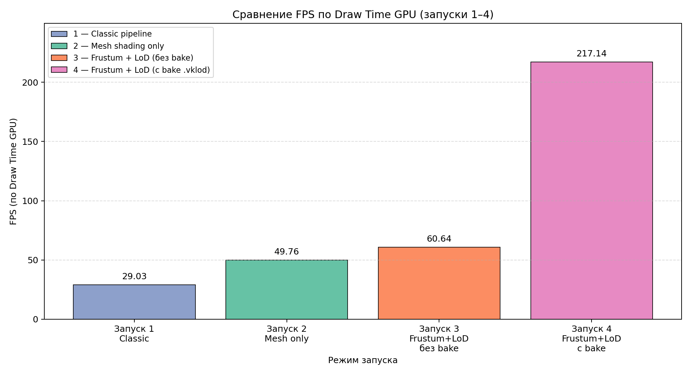
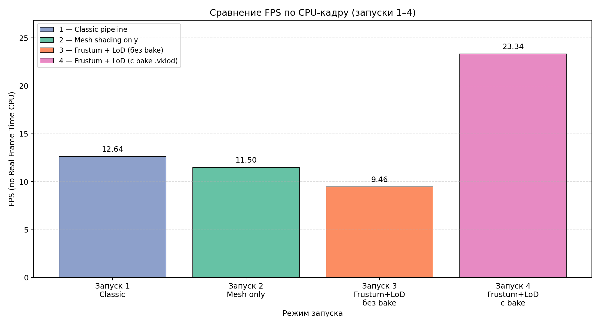
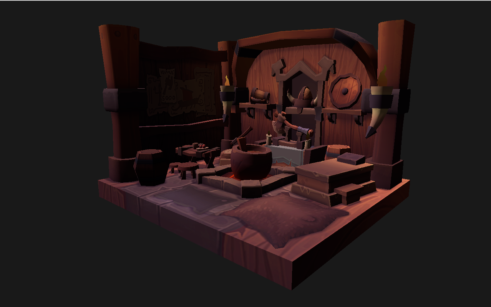
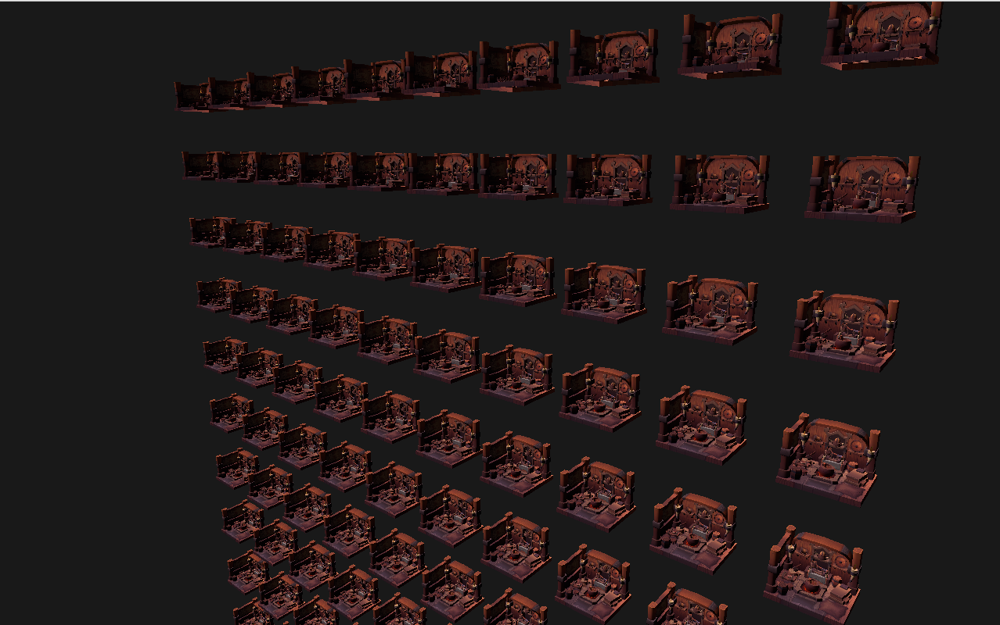

# vulkan_dev

Движок на C++20 и Vulkan для интерактивной визуализации больших текстурированных полигональных сеток. Он сделан как специализированный контур под цифровые модели зданий и сооружений: геометрия таких сцен часто приходит «полигональным супом», а не замкнутой связной сеткой, и на классическом конвейере упирается и в число вызовов отрисовки, и в объём геометрии на кадр.

Работа выполнена как дипломный проект: исследование техник рендеринга и реализация фазового контура, в котором каждая оптимизация включается поверх предыдущей и измеряется отдельно.



## Зачем

**Объект.** Конвейер рендеринга больших текстурированных полигональных сеток в системах визуализации цифровых моделей зданий и сооружений.

**Цель.** Исследовать существующие техники рендеринга таких сеток и разработать методы, пригодные для визуализации цифровых информационных моделей зданий и сооружений.

Проверяемая гипотеза: сочетание сеточного шейдирования, кластерного представления (мешлеты), отсечения по пирамиде видимости и иерархического выбора уровня детализации с офлайн-предобработкой существенно снижает время кадра и объём CPU-работы по записи команд по сравнению с классическим конвейером Vulkan. Фазовое включение техник позволяет на каждом шаге отделить вклад отдельной оптимизации.

В контур входят статическая геометрия и измерения на GPU с поддержкой `VK_EXT_mesh_shader` (класс NVIDIA RTX 4070 и новее). Трассировка лучей, глобальное освещение, правка геометрии во время кадра и полный GPU-обход иерархии в измеренный контур не входят.

## Технологии и методики

Стек: C++20, Vulkan, расширение `VK_EXT_mesh_shader`, GLFW, GLM, [meshoptimizer](https://github.com/zeux/meshoptimizer), tinyobjloader, stb_image. Шейдеры собираются в SPIR-V через `glslc` или `glslang` (`--target-env vulkan1.3` для сеточного шейдера).

Выбран гибридный путь. Полный GPU-driven конвейер почти убирает работу с CPU, но смешивает вклад отдельных оптимизаций. Классический путь прозрачен для измерений и плохо масштабируется на десятки тысяч подмешей. В движке сеточное шейдирование совмещено с кластерным уровнем детализации, офлайн-предобработкой и обходом иерархии на CPU.

| Критерий | Классический | Сеточное шейдирование | Полный GPU-driven | Гибрид |
| --- | --- | --- | --- | --- |
| Число draw-вызовов | высокое | низкое | минимальное | низкое |
| Нагрузка на CPU | высокая | низкая | минимальная | низкая |
| Гибкость LoD | на объект | на кластер | на кластер | на группу кластеров |
| Прозрачность измерений | высокая | средняя | низкая | высокая |

Переключение классического пути и сеточного шейдирования фиксируется при сборке (`USE_MESH_SHADING`). Фаза уровня детализации переключается без пересборки, переменной `VK_LOD_PHASE`.

### Фазы

| Фаза | Имя | Что включается |
| --- | --- | --- |
| 0 | BaselineCulling | отсечение объектов по пирамиде видимости, без LoD |
| 1 | DataAndCacheApi | контракт данных: `LodLevel`, `LodGroup`, `LodNode`, загрузка кэша |
| 2 | OfflineDiscreteLod | офлайн-уровни и сериализация в `.vklod` |
| 3 | RuntimeDiscreteLod | один уровень на объект по расстоянию и проективному размеру, с гистерезисом |
| 4 | HierarchicalCpuLod | обход иерархии на CPU, смешанный выбор уровня по группам одного объекта |
| 5 | GpuDrivenLod | слот под compute-обход; в кадр не подключён и в замерах не участвует |

Замеры диплома сняты на фазе 4.

### Сеточное шейдирование

Сетка режется на мешлеты. Одна рабочая группа сеточного шейдера обрабатывает один кластер и собирает примитивы напрямую, одним `vkCmdDrawMeshTasksEXT` на объект. Кластеры строит meshoptimizer:

- `meshopt_buildMeshlets`, `meshopt_optimizeMeshlet`
- `max_vertices = 64`, `max_triangles = 124`, `cone_weight = 0.5`
- треугольники мешлета упакованы по три байта в `uint32`, в том же виде их читает шейдер

Классический путь остаётся отдельной сборкой: `vkCmdDrawIndexed` по подмешам, со сменой дескрипторов и push-констант.

### Отсечение и иерархический LoD

До записи команд строится список видимых объектов: мировой AABB проверяется против пирамиды видимости камеры.

Поверх этого на фазе 4 для каждой группы мешлетов считается проективный размер

```text
px = (r_world / d) * H
```

где `r_world` — радиус ограничивающей сферы группы, `d` — расстояние от центра сферы до камеры, `H` — высота кадра. Группа уходит на более грубый уровень `ℓ`, когда проекция меньше порога этого уровня. В смешанном режиме разные группы одного объекта могут оказаться на разных уровнях в одном кадре.

В коде смешанный выбор оценивает проекцию для вертикали 1080 px: `px = (r_world / d) * 1080`. Порог первого перехода — `max(8, VK_LOD_TARGET_PIXELS * 64 * VK_LOD_MIXED_RESPONSE)`, каждый следующий уровень делит порог пополам. Дискретный выбор уровня на весь объект использует гистерезис `1.15×` / `0.85×`, чтобы уровень не дрожал у границы.

### Офлайн-запекание, формат `.vklod`

`lod_baker` — отдельная утилита. Она один раз готовит модель и пишет самодостаточный бинарный кэш. Рантайм больше не гоняет упрощение и группировку, поэтому прогоны между запусками совпадают.

Поток bake:

1. OBJ через tinyobjloader, дедупликация вершин (`meshopt_generateVertexRemap`).
2. Четыре уровня с коэффициентами сохранения треугольников `1.0`, `0.5`, `0.25`, `0.125` через `meshopt_simplify` с постепенным ослаблением ограничения на ошибку.
3. `meshopt_optimizeVertexCache`, `meshopt_optimizeOverdraw`, `meshopt_optimizeVertexFetchRemap`.
4. Мешлеты с параметрами выше.
5. Сортировка центров по Z-кривой Мортона и упаковка в группы по `GROUP_MESHLET_BUDGET = 256`.
6. Иерархия: корень уровня и по листу на группу.
7. Запись `.vklod`.

| Блок | Содержимое |
| --- | --- |
| `FileHeader` | сигнатура `VKLD` (`0x564B4C44`), версия 2, размеры и смещения блоков |
| `LodLevel[]` | коэффициент упрощения, ошибка, диапазоны групп и узлов, корень, блоб геометрии |
| `LodGroup[]` | AABB, сфера, ошибка, диапазон мешлетов |
| `LodNode[]` | сфера, ошибка, дети, ссылка на группу (`UINT32_MAX` у внутреннего узла) |
| `groupMeshlets` | плоский массив индексов мешлетов |
| `Blobs` | позиции, индексы и кластеры по уровням |

Для тестовой модели небоскрёба после запекания:

| LoD | Вершины | Индексы | Мешлеты |
| --- | ---: | ---: | ---: |
| L0 | 2 893 640 | 14 829 813 | 56 960 |
| L1 | 1 307 989 | 7 382 499 | 25 969 |
| L2 | 697 161 | 3 629 769 | 13 716 |
| L3 | 376 560 | 1 835 844 | 7 154 |

На L3 объём геометрии около 13% от L0.

| Без упрощения (L0) | Иерархический LoD (L0–L3) |
| --- | --- |
|  |  |

Подробная разбивка модулей, владения Vulkan-объектами и кадра — в [ARCHITECTURE.md](ARCHITECTURE.md).

## Результаты

Сцена замера — сетка 8×8 экземпляров одной общей модели небоскрёба (64 статических объекта, одна геометрия в памяти). Камера, сцена и интервал логов фиксированы. GPU-время снимается `vkCmdWriteTimestamp`, процесс можно обернуть в `/usr/bin/time -v`.

Конфигурация опубликованных прогонов: NVIDIA GeForce RTX 5070 Ti Laptop GPU (драйвер 595.71.05), Intel Core Ultra 7 255HX, 30 GiB ОЗУ, Linux 6.17, Vulkan Runtime 1.4.335, GLFW 3.4, окно 1920×1200. В коде окно по умолчанию сейчас `1280×800` (`DEFAULT_WIDTH` / `DEFAULT_HEIGHT` в `include/window.hpp`); для повторения таблицы его нужно выставить в 1920×1200. Swapchain берёт `VK_PRESENT_MODE_MAILBOX_KHR`, если режим доступен, иначе `FIFO`.

| Запуск | Конфигурация | Real Frame (CPU), мс | Draw Time (GPU), мс | Command Record, мс | FPS по CPU | FPS по GPU |
| --- | --- | ---: | ---: | ---: | ---: | ---: |
| 1 | классический конвейер | 79,11 | 34,44 | 68,92 | 12,64 | 29,03 |
| 2 | только сеточное шейдирование | 86,99 | 20,10 | 0,08 | 11,50 | 49,76 |
| 3 | отсечение и LoD без bake | 105,67 | 16,49 | 0,06 | 9,46 | 60,64 |
| 4 | отсечение и LoD с `.vklod` | 42,85 | 4,61 | 0,05 | 23,34 | 217,14 |
| Ogre-Next 2.x | Vulkan RS, flyover той же сцены | 48,04 | — | — | — | — |

По GPU-отрисовке шаги дают около +71% (1→2), +22% (2→3) и +258% (3→4). От запуска 1 к запуску 4 скорость отрисовки на GPU вырастает примерно в 7,5 раза (34,44 → 4,61 мс). Время записи командного буфера падает с 68,92 до 0,05 мс уже на переходе к сеточному шейдеру. Время кадра на CPU немонотонно: запуски 2 и 3 включают ожидание синхронизации, выигрыш по CPU виден на полном контуре (79,11 → 42,85 мс). На стабильном flyover запуск 4 (42,85 мс) быстрее прогона Ogre-Next (48,04 мс); это сравнение специализированного контура с универсальным движком.






## Сборка и запуск

Зависимости (Debian/Ubuntu):

```bash
sudo apt install build-essential cmake pkg-config \
  libglfw3-dev libglm-dev libvulkan-dev glslang-tools libgtest-dev \
  libx11-dev
```

Нужны драйвер Vulkan и GPU с `VK_EXT_mesh_shader` для сборки с сеточным шейдером. `libgtest-dev` требует корневой `CMakeLists.txt`, хотя отдельных тестов в дереве нет. Сборка в исходном каталоге запрещена.

Сеточное шейдирование задаётся опцией CMake `USE_MESH_SHADING`. Классический путь и mesh-путь собираются двумя разными деревьями. В командах экспериментов диплома тот же переключатель записан префиксом `USE_MESH_SHADING=ON|OFF`: это метка конфигурации сборки.

```bash
# Запуск 1: классический конвейер
cmake -S . -B build-classic -DUSE_MESH_SHADING=OFF
cmake --build build-classic -j

# Запуски 2–4: сеточное шейдирование и LoD
cmake -S . -B build-mesh -DUSE_MESH_SHADING=ON
cmake --build build-mesh -j
```

Опция `BUILD_LOD_BAKER` включена по умолчанию и собирает `lod_baker`. `ENABLE_DEBUG_SYMBOLS` (по умолчанию ON) добавляет `-g`.

Исполняемый файл лежит в `build-*/src/VKSOURCES`. Модели ищутся относительно этого каталога (`../../src/src/assets/...`), поэтому запускать нужно из `build-*/src`.

Запекание кэша (один раз на модель):

```bash
./build-mesh/lod_baker \
  src/src/assets/skycreeper/London_Bridge_Quarter_Combined2resave_in_6-0_verified.obj \
  src/src/assets/skycreeper/London_Bridge_Quarter_Combined2resave_in_6-0_verified.vklod
```

Готовый `.vklod` этой модели уже лежит рядом с OBJ.

Четыре режима диплома, сцена `SCENE_MODE=1`:

```bash
cd build-classic/src
SCENE_MODE=1 VK_LOD_ENABLE=0 ./VKSOURCES

cd ../../build-mesh/src
SCENE_MODE=1 VK_LOD_ENABLE=0 ./VKSOURCES

SCENE_MODE=1 VK_LOD_ENABLE=1 VK_LOD_PHASE=3 ./VKSOURCES

SCENE_MODE=1 VK_LOD_ENABLE=1 VK_LOD_PHASE=4 \
  VK_MODEL_LOD_CACHE=../../src/src/assets/skycreeper/London_Bridge_Quarter_Combined2resave_in_6-0_verified.vklod \
  ./VKSOURCES
```

Без `VK_MODEL_LOD_CACHE` модель читается из OBJ. Если кэш задан, рантайм берёт его и OBJ для геометрии не нужен.

| Переменная | Назначение | По умолчанию |
| --- | --- | --- |
| `SCENE_MODE` | `1` или `SKY_8X8` — сетка 8×8 | `SKY_8X8` |
| `VK_LOD_ENABLE` | `1` включает контур LoD | выключен |
| `VK_LOD_PHASE` | фаза 0–5 | 0 |
| `VK_MODEL_LOD_CACHE` | путь к `.vklod` небоскрёба | пусто, загрузка OBJ |
| `VK_LOD_FORCE_LEVEL` | фиксированный уровень, `-1` — автовыбор | `-1` |
| `VK_LOD_TARGET_PIXELS` | целевой порог проекции | `1.5` |
| `VK_LOD_MIXED_RESPONSE` | чувствительность смешанного LoD: больше 1 переключает на грубый уровень раньше | `1.0` |
| `VK_LOD_DEBUG` | лог выбора уровней | выключен |
| `VK_LOD_DEBUG_INTERVAL` | период лога, секунды | `1.0` |
| `VK_LOD_DEBUG_MAX_OBJECTS` | сколько объектов печатать | `3` |

Управление камерой: `W A S D` — движение в плоскости, `Q` / `E` — вниз и вверх, стрелки — обзор.

## Состав репозитория

| Путь | Содержание |
| --- | --- |
| `src/src/` | кадр, устройство, пайплайн, сцена, шейдеры |
| `include/` | заголовки, контракт LoD (`lod.hpp`) |
| `tools/lod_baker.cpp` | офлайн-запекание `.vklod` |
| `meshoptimizer/` | библиотека упрощения и кластеризации |
| `src/src/assets/skycreeper/` | OBJ, MTL и готовый `.vklod` тестовой модели |
| `images/` | кадры сцены, сравнение LoD и графики замеров |

Ранние сцены на том же конвейере: комната, несколько комнат, персонаж и набор сеток.



